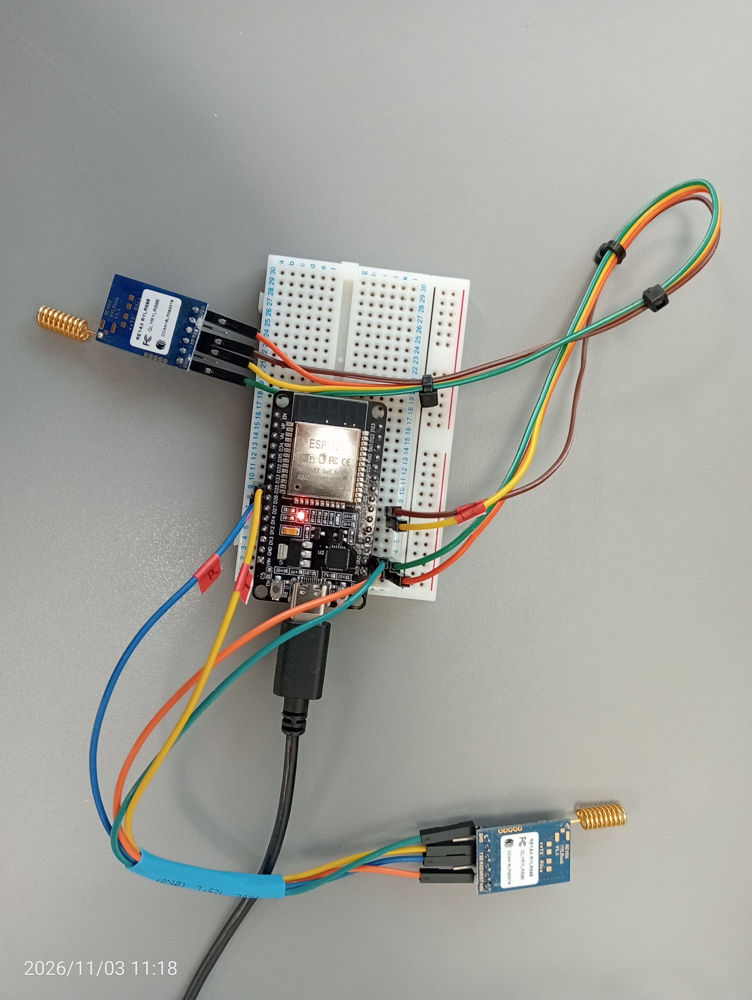
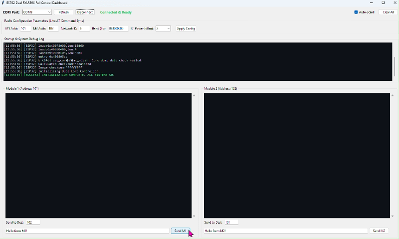
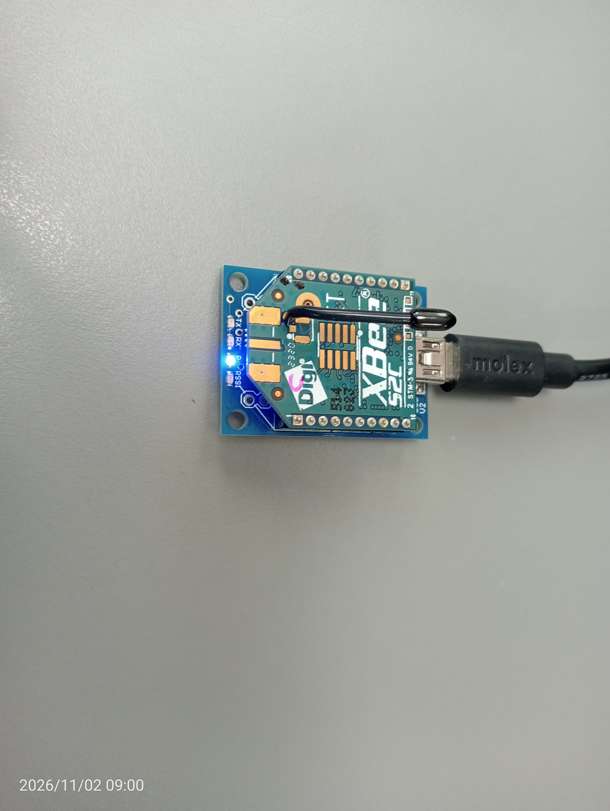
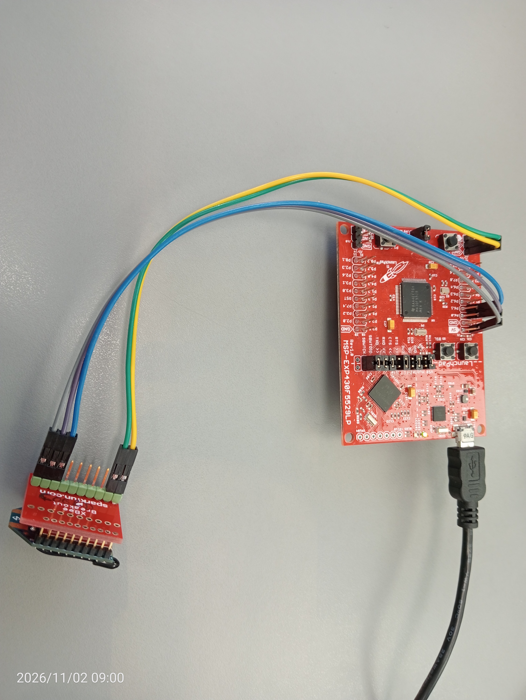
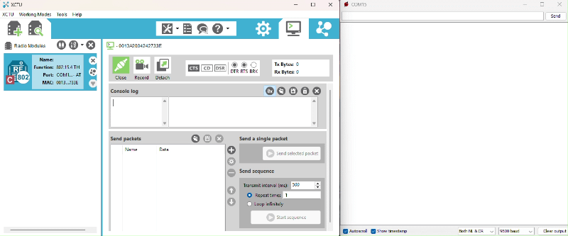

# Wireless Communication Projects Portfolio

A collection of embedded wireless communication systems featuring multi-module LoRa control dashboards and 802.15.4 Zigbee/XBee serial links.

---

## Projects Overview

1. **ESP32 Dual RYLR896 LoRa Controller & GUI Dashboard**
   - A dual-module LoRa communication system powered by an ESP32 microcontroller running custom Arduino firmware and managed via a Python/Tkinter desktop dashboard for simultaneous configuration, bidirectional messaging, and live RSSI monitoring.

2. **XBee S2C Wireless Communication with MSP-ESP430F5529LP**
   - A wireless serial communication link established between XBee S2C modules using Digi XCTU, an MSP-ESP430F5529LP microcontroller board, and a Hobbytronics XBee-USB adapter.

---

## 1. ESP32 Dual RYLR896 LoRa Controller & GUI Dashboard

  

<em>Figure 1: Complete hardware wiring of the ESP32 breadboard setup connected to dual RYLR896 LoRa modules.</em>

   
  <em>Animation 1: Live demonstration of wireless data transmission RYLR896_Dashboard1.py.</em>

### Key Highlights
- **Microcontroller (ESP32):** Manages two separate hardware serial interfaces (HardwareSerial LoRa1 on UART2 and HardwareSerial LoRa2 on UART1) to interface simultaneously with dual RYLR896 transceiver modules, parsing live AT commands and handling packet forwarding.
- **Desktop Control Software (Python/Tkinter):** Provides a GUI dashboard featuring a live COM port selector, real-time status indicators, a startup/system debug console, live AT configuration parameter sync, and split-pane messaging consoles with custom color-coded TX/RX logs.

---

## 2. XBee S2C Wireless Communication with MSP-ESP430F5529LP

  

<em>Figure 2: Coordinator XBee S2C module mounted on a Hobbytronics XBee-USB board.</em>

  

<em>Figure 3: End Device XBee S2C module connected to an MSP-ESP430F5529LP LaunchPad board.</em>

### Key Highlights
- **Hardware Architecture:** Features a Coordinator node connected via a USB adapter to a host computer running Digi XCTU, paired with an End Device node wired to an MSP-ESP430F5529LP LaunchPad board.
- **802.15.4 Protocol:** Configured with matching PAN IDs and channels using Digi XCTU for reliable wireless serial bridging and packet transmission.

   
  <em>Animation 2: Live demonstration of wireless data transmission using the XCTU console.</em>

